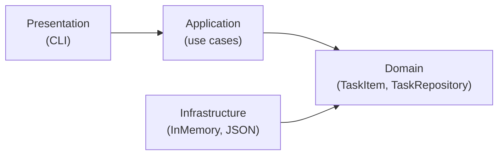

# lab5_clean_architecture

Навчальний консольний застосунок **обліку завдань** (`TaskItem`) на чистому Dart (без Flutter і зовнішніх пакетів, окрім dev-залежності `test`). Проєкт створено для лабораторної роботи №5 «Побудова архітектури застосунку. Робота з Git» і демонструє шарову (чисту) архітектуру та роботу з Git (гілки, pull request, код-рев'ю, розв'язання конфлікту, реліз).

## Можливості

- створити завдання (заголовок не може бути порожнім);
- переглянути список завдань (за часом створення);
- завершити завдання (двічі завершити не можна);
- видалити завдання;
- сховище обирається в `config/settings.json`: `memory` (пам'ять) або `json` (файл).

## Архітектура

Проєкт поділено на чотири шари. Залежності напрямлені до **domain**: він нічого не знає про інші шари (принцип інверсії залежностей).



| Шар | Каталог | Відповідальність |
| --- | --- | --- |
| Domain | `lib/src/domain` | сутність `TaskItem`, бізнес-правила, винятки, інтерфейс `TaskRepository` |
| Application | `lib/src/application` | use cases: створення, завершення, список, видалення; залежать лише від domain |
| Infrastructure | `lib/src/infrastructure` | реалізації `TaskRepository`: `InMemoryTaskRepository`, `JsonTaskRepository` |
| Presentation | `lib/src/presentation` | консольне меню `CliApp`, без бізнес-логіки |

**Composition root** — `bin/lab5_clean_architecture.dart`: читає налаштування, створює реалізацію `TaskRepository`, передає її в use cases через конструктор, а use cases — у `CliApp` (Dependency Injection). Напрямок залежностей автоматично перевіряє `test/architecture_test.dart`.

### Структура каталогів

```text
lab5_clean_architecture/
├── bin/
│   └── lab5_clean_architecture.dart      # composition root (DI)
├── config/
│   └── settings.json                     # тип і шлях сховища
├── lib/
│   ├── lab5_clean_architecture.dart      # публічні експорти пакета
│   └── src/
│       ├── domain/
│       │   ├── entities/task_item.dart
│       │   ├── exceptions/domain_exception.dart
│       │   └── repositories/task_repository.dart
│       ├── application/
│       │   └── use_cases/                # create, complete, list, delete
│       ├── infrastructure/
│       │   └── repositories/             # in_memory_..., json_...
│       └── presentation/
│           └── cli/cli_app.dart
├── test/
│   ├── architecture_test.dart            # перевірка напрямку залежностей
│   └── use_cases_test.dart               # unit-тести use cases
├── analysis_options.yaml
└── pubspec.yaml
```

## Конфігурація

`config/settings.json`:

```json
{
  "storage": {
    "type": "json",
    "path": "data/tasks_local.json"
  }
}
```

- `type`: `json` (зберігання у файлі за `path`) або `memory` (дані живуть лише під час роботи програми);
- `path`: шлях до JSON-файлу (каталоги створюються автоматично).

## Збірка та запуск

Потрібен Dart SDK 3.14 або новіший. Команди виконуються в корені репозиторію:

```powershell
dart pub get      # завантажити залежності
dart analyze      # статичний аналіз
dart test         # unit- та архітектурні тести
dart format --set-exit-if-changed .   # перевірка форматування
dart run          # запустити застосунок
```

### Як користуватися

Після `dart run` з'являється меню; введіть номер пункту й натисніть Enter:

| Пункт | Дія |
| --- | --- |
| `1` | створити завдання (далі введіть заголовок) |
| `2` | показати список завдань (`[ ]` — активне, `[x]` — завершене) |
| `3` | завершити завдання (введіть його номер зі списку) |
| `4` | видалити завдання (введіть його номер зі списку) |
| `0` | вийти |

Команди можна подавати і через pipe, наприклад: `"1`nКупити хліб`n2`n0" | dart run` (PowerShell).

Інший файл налаштувань можна передати аргументом: `dart run bin/lab5_clean_architecture.dart config/settings.json`.

## Політика гілок

- `main` — стабільний код; потрапляє лише через реліз (злиття з `develop`), на коміти ставляться теги версій (`v1.0.0`).
- `develop` — інтеграційна гілка; в неї зливаються всі завершені функціональні гілки через pull request.
- `feature/*` — короткоживучі гілки під окремі задачі (`feature/domain-layer`, `feature/application-layer`, `feature/infrastructure-layer`, `feature/presentation-layer`, `feature/docs-readme`); створюються від `develop` і зливаються назад у `develop`.

Гілки після злиття не видаляються, історія не переписується (без `rebase` і `force push`).

Повідомлення комітів — українською, за Conventional Commits (`feat`, `fix`, `refactor`, `docs`, `test`, `chore`, `merge`), наприклад: `feat(domain): додати сутність TaskItem`.
